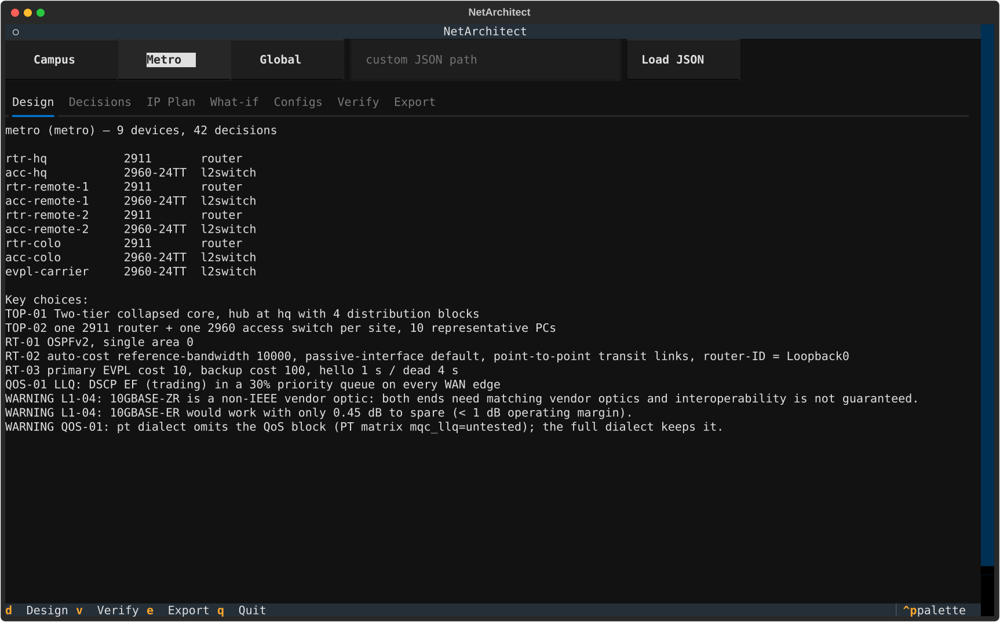
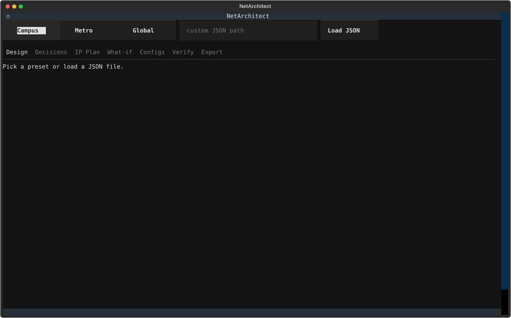
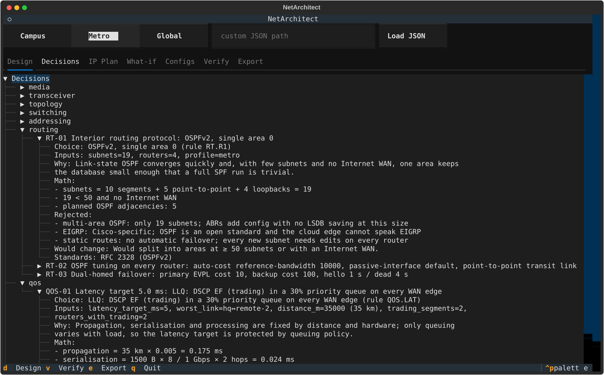
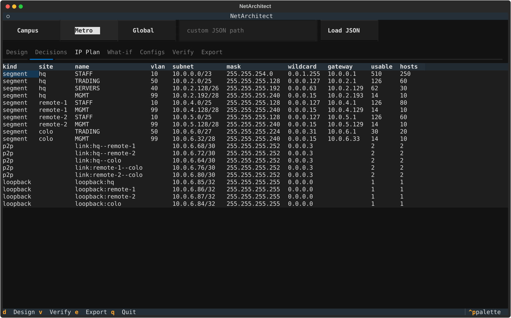
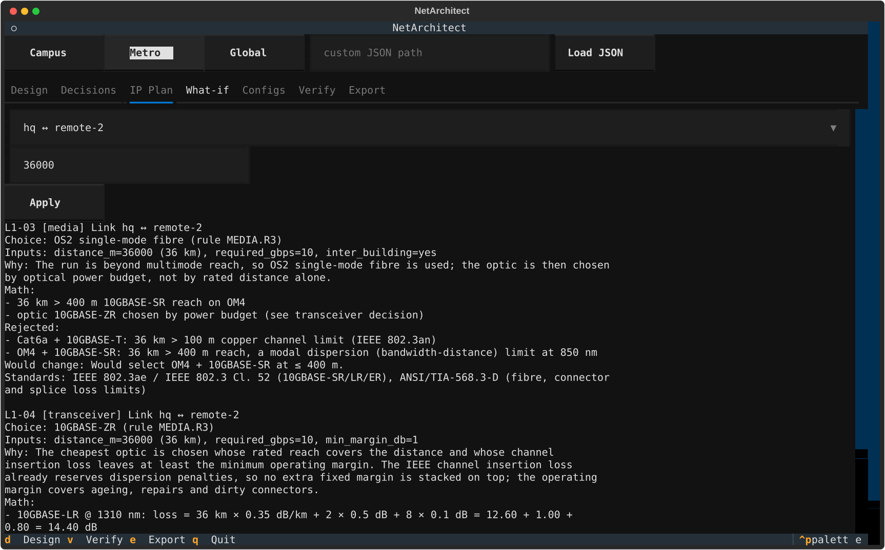
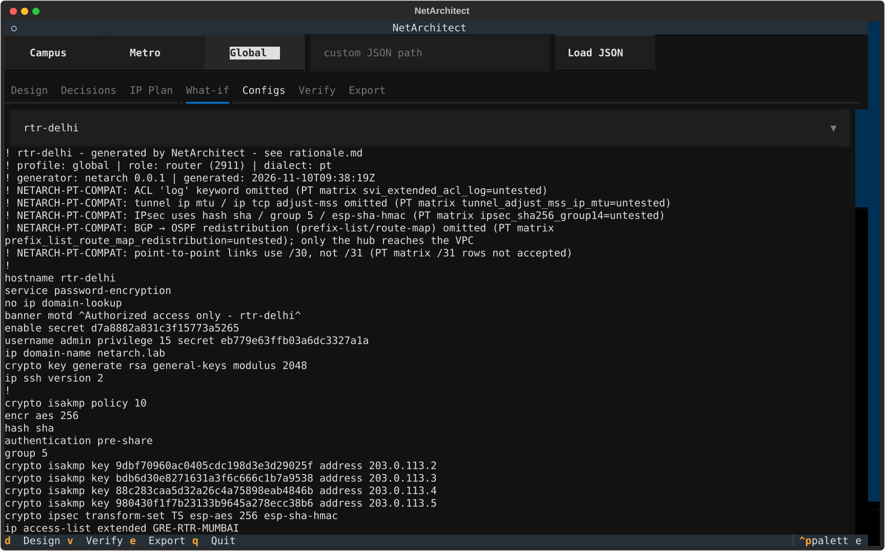
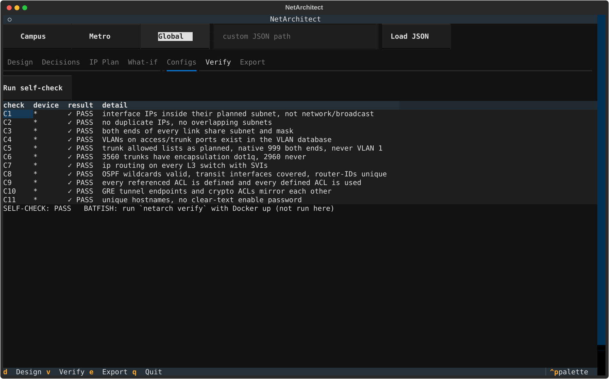
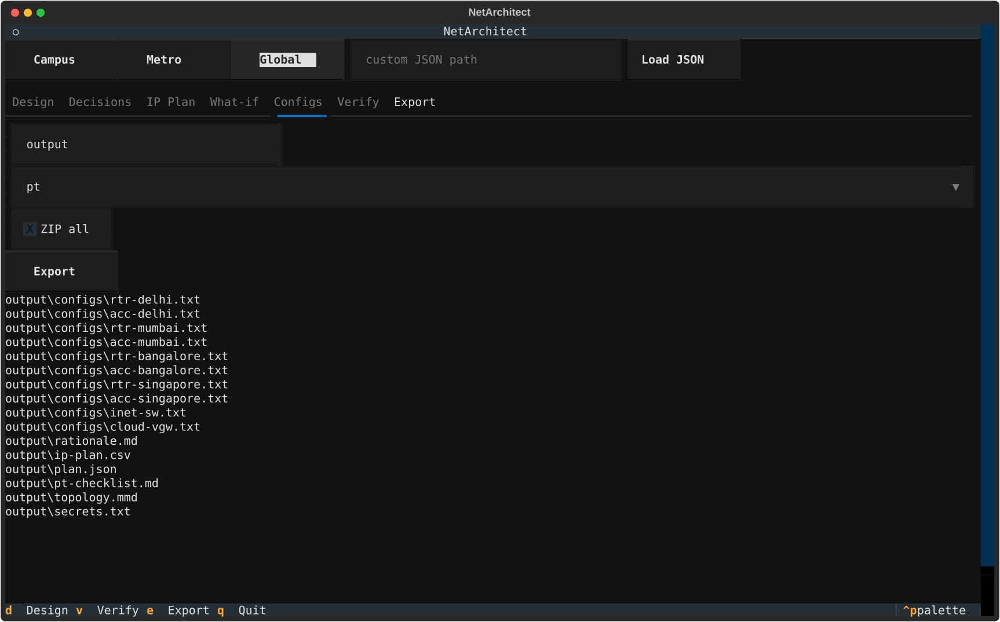

# NetArchitect

**A junior network architect in your terminal.** Describe an organisation (its sites, users,
distances and address block) and NetArchitect designs the whole network. It explains every
decision with the numbers and standards behind it, writes copy-paste-ready Cisco IOS configs for
every router and switch, and then verifies its own output.

CIC-307 Computer Networks mini-project · Python 3.12 · Textual TUI + Typer CLI · MIT licence.



---

## Contents

1. [Why it exists](#1-why-it-exists)
2. [How it helps](#2-how-it-helps)
3. [What it does, stage by stage](#3-what-it-does-stage-by-stage)
4. [The three presets](#4-the-three-presets)
5. [Screenshots: the TUI dashboard](#5-screenshots-the-tui-dashboard)
6. [Install](#6-install)
7. [Run it: TUI](#7-run-it-tui)
8. [Run it: CLI](#8-run-it-cli)
9. [Custom input (your own organisation)](#9-custom-input-your-own-organisation)
10. [What you get out (exports)](#10-what-you-get-out-exports)
11. [An explained decision, in full](#11-an-explained-decision-in-full)
12. [Generated configs and the two dialects](#12-generated-configs-and-the-two-dialects)
13. [Verification](#13-verification)
14. [Tests](#14-tests)
15. [Project layout](#15-project-layout)
16. [Known limitations and status](#16-known-limitations-and-status)
17. [Documentation index](#17-documentation-index)

---

## 1. Why it exists

Even a small enterprise network involves dozens of linked decisions:

- which cable or fibre to use for each run, and which transceiver;
- how to split an address block into subnets without overlap or waste;
- which VLANs exist, which links trunk them, and where spanning tree is rooted;
- which routing protocol to use, how many OSPF areas, whether BGP is needed;
- how to protect sites that talk over the Internet, and which traffic to filter.

Each of these choices follows from physics, standards and arithmetic: fibre attenuation and
dispersion, IEEE 802.3 reach limits, binary subnet maths, OSPF scaling. In practice people make
them by gut feeling or copy configs from old projects. Generative AI makes this worse, because it
writes configs that *look* right but break in small ways: a mask off by one bit, a trunk that
allows every VLAN, an LR optic on a 35 km link.

NetArchitect makes every one of these decisions with a **rule engine**, shows the working, and
checks the result.

## 2. How it helps

| Who | How NetArchitect helps |
|---|---|
| **Students learning networking** | Every choice comes with the maths and the standard. Examples: why OM4 stops at 400 m (modal dispersion, not attenuation); why 254 hosts need a /23 (the gateway takes an address); why OSPF over plain IPsec fails (multicast hellos). A *what-if* tab lets you change a distance and watch copper → OM4 → LR → ER → ZR. |
| **Anyone building a lab** | Generates configs for **every** device plus a Packet Tracer build sheet: the device list, a cabling table with exact port names, load steps, and the `show` commands with their expected results. |
| **Reviewers / validators of AI-written configs** | An 11-rule self-check and optional Batfish analysis turn "this config looks wrong" into evidence. Examples: duplicate IPs, trunk/VLAN mismatches, invalid OSPF wildcards, unmirrored tunnels. |
| **Network designers** | A fast first draft: VLSM plan with per-site summaries, OSPF area design, failover costs, IPsec suite, QoS budget, and ACLs placed near the source. All of it can be exported as JSON, CSV and Markdown. |

Design rule: **no AI makes design decisions**. Every rule and constant is fixed in code and data
files (`netarch/data/*.yaml`, each constant with a cited source), so the same input always gives
the same, explainable output.

## 3. What it does, stage by stage

```
 preset / custom JSON
   → validate (every bad field reported at once)
   → L1 media & optics → topology tier & L2 → VLSM addressing
   → lab mapping (devices, ports, cables) → VPN → routing → QoS → ACLs
   → NetworkPlan + explained Decisions
   → Cisco IOS configs (pt | full dialect) → self-check · Batfish · Packet Tracer checklist
   → exports (.txt per device, ZIP, rationale.md, ip-plan.csv, plan.json, topology.mmd)
```

Each stage is a pure function (plan in, plan out). That keeps each one independently testable and
lets the TUI re-run the design instantly when you change an input.

| Stage | What it decides | Rules and maths |
|---|---|---|
| **Validation** | Rejects bad input with field, value, rule and a fix hint | VLAN 2–4094 (not 1, 999, 1002–1005); strict CIDR; RFC 1918 reserved/VPC ranges; copper > 100 m → `PhysicalDistanceViolationError`; dual-homed sites need 2 links; size caps |
| **L1 media** | Cat6a vs OM4 vs OS2 for each link | ≤ 100 m copper channel (IEEE 802.3an); ≤ 400 m OM4 10GBASE-SR (modal dispersion); beyond → OS2. Links between buildings always get fibre (ground-potential difference, lightning) |
| **Transceiver** | LR / ER / ZR by **optical power budget** | loss = km × α(λ) + connectors × 0.5 dB + splices × 0.1 dB; the cheapest optic with reach and margin ≥ 1 dB, otherwise `OpticalBudgetExceededError` |
| **Topology** | Collapsed core vs three-tier; full mesh vs hub | full mesh n(n−1)/2 links vs hub n−1; thresholds in `topology.yaml` |
| **L2** | VLANs, trunks, RSTP, access-switch count, PoE | exact allowed VLAN lists, native VLAN 999, `nonegotiate`, rapid-PVST root on the gateway switch, ports = ceil((wired + APs) / 24), PoE = APs × 30 W |
| **VLSM** | Every subnet, gateway, loopback and link subnet | integer bit maths (no `ipaddress` in production code); needed = ceil(hosts × (1 + growth)) + 1 gateway; one aligned block per site so **each site is one summary route**; /31 or /30 links from the Packet Tracer capability matrix; /32 loopbacks |
| **Lab mapping** | Real Packet Tracer devices and port names | per site: one 2911 router or 3560 distribution switch, one 2960 access switch, one PC per segment; Metro EVPL carrier switch; Global "Internet" switch on RFC 5737 space |
| **Routing** | OSPF single/multi-area, failover, BGP | < 50 subnets and no Internet WAN → area 0; Global → multi-area with ABR `area n range`; reference bandwidth 10 Gbps; passive by default; Metro dual-homing: cost 10 primary / 100 backup, hello 1 s / dead 4 s; eBGP 65001 ↔ 64512 to the cloud with a Null0 anchor and a VPC-only prefix-list |
| **VPN** | GRE-over-IPsec hub and spoke | GRE carries OSPF multicast; IKEv1 crypto map; SHA-256/DH group 14 (full) or the Packet Tracer fallback; ip mtu 1400 / tcp adjust-mss 1360 |
| **QoS** | LLQ when a latency target is set | latency = km × 0.005 ms + serialisation + hops × 0.05 ms; the rest is the queuing budget (Metro: 0.30 ms used, 4.70 ms left); DSCP EF priority 30 % |
| **Security** | ACLs near the source, management access | WIFI → MGMT deny, WIFI → SERVERS tcp 80/443 + udp 53 only; colo trading reachable from HQ trading only; IoT → collectors tcp 8883/443, udp 53/123; VPC from HQ servers only; SSH-only VTY with `access-class`; every ACL ends with an explicit deny |

## 4. The three presets

| | **campus** | **metro** | **global** |
|---|---|---|---|
| Sites | 3 buildings | HQ, 2 remote sites, colo | Delhi (HQ), Mumbai, Bangalore, Singapore + cloud VPC |
| Hosts | 1,580 | 540 (450 users + trading/servers) | 2,610 incl. 2,000 IoT |
| Distances | 180–390 m between buildings | 15–35 km EVPLs | Internet (no physical links) |
| Physical | OM4 + 10GBASE-SR between buildings | OS2, ER/ZR chosen by power budget | out of scope |
| L3 | single-area OSPF, routed /30 triangle, SVIs | single-area OSPF, dual-homed failover, LLQ for < 5 ms | multi-area OSPF, GRE-over-IPsec, eBGP to the cloud |
| Lab devices | 6 (3× 3560, 3× 2960) | 9 (4× 2911, 5× 2960) | 10 (5× 2911 incl. cloud-vgw, 5× 2960) |

All presets use `10.0.0.0/16`. Their JSON lives in `netarch/presets/`.

## 5. Screenshots: the TUI dashboard

There is **no web frontend**. The interactive "dashboard" is a full-screen terminal UI built with
[Textual](https://textual.textualize.io/) (mouse and keyboard). These screenshots are real
captures of the app (`tools/screenshots.py`, 140 × 42).

**Home:** preset buttons, a custom-JSON loader, and the tabs.


**Design summary (Metro):** devices, models, roles and the key decisions.


**Decisions tree:** every decision grouped by domain. Expand one to see its inputs, the "why",
the maths, the rejected options, the counterfactual and the standards.


**IP plan:** subnet, mask, **wildcard**, gateway, usable hosts and requested hosts for every
segment, link and loopback.


**What-if:** change a link distance (here HQ ↔ Remote-2 → 36 km); the media and optic decisions
re-run live.


**Config viewer:** the generated IOS for any device (here the Global hub `rtr-delhi`, `pt`
dialect, with its compatibility header).


**Verify:** the 11 self-check invariants, each shown as ✓ PASS / ✗ FAIL (always as words, never
colour alone).


**Export:** choose the destination, dialect and ZIP; the panel lists every file written.


To regenerate the screenshots: `.venv/Scripts/python tools/screenshots.py`.

## 6. Install

Requirements: **Python 3.12** (Windows, macOS or Linux). Docker is optional and only needed for
Batfish.

```
git clone https://github.com/haragam22/cn-mini-project.git
cd cn-mini-project
py -3.12 -m venv .venv                       # macOS/Linux: python3.12 -m venv .venv
.venv/Scripts/python -m pip install -e .[dev] # macOS/Linux: .venv/bin/python -m pip install -e .[dev]
.venv/Scripts/netarch --help
```

(On macOS/Linux use `.venv/bin/` wherever this README says `.venv/Scripts/`.)

## 7. Run it: TUI

```
.venv/Scripts/netarch
```

Use a terminal of at least **120 × 35** (Windows Terminal recommended).

1. Click **Campus**, **Metro** or **Global**, or type a JSON path and click **Load JSON**.
   Invalid input lists every bad field with its rule and a hint; the app does not crash.
2. **Design**: summary of devices and key choices.
3. **Decisions**: expand any domain and decision.
4. **IP Plan**: the addressing table with wildcards.
5. **What-if**: pick a link, type a distance in metres, then **Apply**.
6. **Configs**: pick a device to see its IOS config.
7. **Verify**: **Run self-check**.
8. **Export**: choose the folder, `pt` or `full`, optionally **ZIP all**, then **Export**.

Keys: `d` design · `v` verify · `e` export · `q` quit.

## 8. Run it: CLI

Every TUI feature also exists as a scriptable command:

```
netarch presets                                    # list presets
netarch validate  --input my-org.json              # validation only
netarch design    --preset campus                  # devices + key decisions
netarch design    --preset campus --json           # the full plan as JSON
netarch explain   --preset metro                   # every decision, explained
netarch explain   --preset metro --id L1-04        # one decision (35 km ZR case)
netarch explain   --preset global --domain routing --markdown
netarch plan      --preset global                  # VLSM table with masks and wildcards
netarch export    --preset campus --out ./output --zip --dialect pt
netarch export    --preset metro  --only configs,rationale --dialect full
netarch verify    --preset global                  # self-check + Batfish (skipped if not running)
netarch verify    --preset metro --no-batfish --report ./output/batfish-report.md
netarch checklist --preset metro                   # Packet Tracer build + test sheet
netarch --debug design --input my-org.json         # show the stack trace on errors
```

**Exit codes:** `0` ok · `1` verification failed · `2` input invalid (including unreadable files
or an unwritable `--out`) · `3` design constraint error (distance, optical budget, address
exhaustion, port/PoE capacity). Errors print as a panel with the field, value, rule and a fix
hint, never as a stack trace (unless you pass `--debug`).

## 9. Custom input (your own organisation)

Write a JSON file (full schema in `docs/technical.md` §4.1) and pass it with `--input`, or load it
in the TUI:

```json
{
  "profile_name": "my-campus",
  "profile_type": "campus",
  "address_space": { "root": "10.0.0.0/16", "reserved": ["10.0.255.0/24"] },
  "sites": [
    { "id": "bldg-a", "kind": "building", "access_points": 8, "access_run_max_m": 85,
      "segments": [
        { "name": "STAFF", "vlan": 10, "hosts": 200, "growth_pct": 20, "role": "users" },
        { "name": "WIFI",  "vlan": 20, "hosts": 220, "growth_pct": 20, "role": "wireless" },
        { "name": "MGMT",  "vlan": 99, "hosts": 20,  "growth_pct": 0,  "role": "management" }
      ] },
    { "id": "bldg-b", "kind": "building",
      "segments": [ { "name": "STAFF", "vlan": 10, "hosts": 180, "growth_pct": 20, "role": "users" } ] }
  ],
  "links": [
    { "a": "bldg-a", "b": "bldg-b", "distance_m": 180, "inter_building": true, "required_gbps": 10 }
  ],
  "resiliency": "dual_uplink",
  "latency_target_ms": null,
  "cloud": null,
  "target_dialect": "pt"
}
```

| Field | Values |
|---|---|
| `profile_type` | `campus` (L3 switches) · `metro` (routers + EVPL carrier) · `global` (routers + Internet VPN, multi-area OSPF, optional cloud) |
| `kind` | `building`, `hq`, `remote`, `colo`, `city` |
| `role` | `users`, `wireless`, `management`, `servers`, `labs`, `iot`, `trading` (roles drive the ACL policy) |
| `resiliency` | `dual_uplink` (two access uplinks) · `dual_homed` (every `remote` site needs 2 links; failover costs and timers) |
| `requested_media` | `null` (let the engine choose), `copper`, `om4`, `os2` |
| `latency_target_ms` | set it to get the latency budget and LLQ |
| `cloud.vpc_cidr` | RFC 1918 range outside the root (Global builds eBGP to it) |

Limits: up to 64 sites, 256 links, 24 segments per site, 2^24 hosts per segment. Names must be
printable ASCII (1–64 characters). Site ids must not contain `--` and must not use the names the
lab reserves (`cloud-vgw`, `inet-sw`, `evpl-carrier`, `cloud`, `internet`, `carrier`, `infra`).

## 10. What you get out (exports)

`netarch export --preset <p> --out ./output [--zip] [--dialect pt|full]` writes:

| File | Contents |
|---|---|
| `configs/<hostname>.txt` | one complete IOS config per device; paste it into the device CLI |
| `rationale.md` | every decision, grouped by domain, with all its reasoning |
| `ip-plan.csv` | the addressing table (spreadsheet-safe) |
| `plan.json` | the whole machine-readable design (devices, interfaces, routing, tunnels, ACLs, QoS, decisions) |
| `pt-checklist.md` | Packet Tracer device list, cabling table, load steps, verification commands with expected results |
| `topology.mmd` | Mermaid diagram of devices, cables and tunnels |
| `secrets.txt` | generated enable/admin passwords and IPsec pre-shared keys (owner-only file, git-ignored) |
| `netarch-<profile>-configs.zip` | configs + rationale + checklist, without `secrets.txt` |

The configs themselves contain the generated secrets, so treat the `configs/` folder and the ZIP
as sensitive.

## 11. An explained decision, in full

`netarch explain --preset metro --id L1-04` (the 35 km HQ ↔ Remote-2 link):

```
L1-04 [transceiver] Link hq ↔ remote-2
  Choice: 10GBASE-ZR (rule MEDIA.R3)
  Inputs: distance_m=35000 (35 km), required_gbps=10, min_margin_db=1
  Math:
    - 10GBASE-LR @ 1310 nm: loss = 35 km × 0.35 dB/km + 2 × 0.5 dB + 8 × 0.1 dB = 14.05 dB
    - 10GBASE-LR margin = 6.2 − 14.05 = -7.85 dB < 1 dB; reach 10 km < 35 km
    - 10GBASE-ER @ 1550 nm: loss = 35 km × 0.25 dB/km + 2 × 0.5 dB + 8 × 0.1 dB = 10.55 dB
    - 10GBASE-ER margin = 11 − 10.55 = 0.45 dB < 1 dB; reach 40 km ≥ 35 km
    - 10GBASE-ZR margin = 23 − 10.55 = 12.45 dB ≥ 1 dB; reach 80 km ≥ 35 km
  Rejected:
    - 10GBASE-LR: rated reach 10 km < 35 km; loss at 1310 nm would be 14.05 dB vs 6.2 dB budget
    - 10GBASE-ER: margin 0.45 dB < 1 dB minimum operating margin (loss 10.55 dB vs 11 dB budget)
  Would change: Would select 10GBASE-ER if distance ≤ 40 km and loss ≤ 10.00 dB.
  WARNING: 10GBASE-ZR is a non-IEEE vendor optic: both ends need matching vendor optics.
  Standards: Cisco SFP-10G-ZR data sheet, ANSI/TIA-568.3-D
```

Every decision (media, transceiver, topology, switching, addressing, routing, VPN, QoS, security)
has the same structure: **choice, inputs, rule id, why, maths, rejected options, counterfactual,
warnings, standards**. Engines never write prose. They fill these fields, and one renderer turns
them into text, so every number in a rationale comes from the actual inputs.

## 12. Generated configs and the two dialects

Each config follows the same skeleton: hostname → password encryption → banner → SSH user and keys
→ VLAN database → spanning tree → crypto/QoS definitions → interfaces (physical, sub-interface,
SVI, loopback, tunnel) → `ip routing` → OSPF/BGP → static routes → prefix-lists/route-maps → ACLs
→ console/VTY lines.

| Dialect | For | Difference |
|---|---|---|
| `full` | real IOS and Batfish | everything: SHA-256/group 14 IPsec, MQC LLQ, `log` on ACL denies, tunnel MTU/MSS, BGP → OSPF redistribution |
| `pt` | pasting into **Packet Tracer** | features not yet confirmed in Packet Tracer are removed or downgraded, and each one is listed in a `! NETARCH-PT-COMPAT:` header |

What `pt` can use is driven by `netarch/data/pt_capabilities.yaml`. When you test a feature in
Packet Tracer and mark it `accepted` (guide: `docs/pt-matrix-guide.md`), the next export uses it,
with no code change. Rows still `untested` give the safe fallback: /30 links instead of /31, SHA-1
with DH group 5, no QoS block, no ACL `log`, no tunnel MTU/MSS, no BGP → OSPF redistribution.

## 13. Verification

**1. Self-check (always runs, no dependencies).** It parses the generated configs (ciscoconfparse2)
against the plan and checks 11 invariants:

| Id | Invariant |
|---|---|
| C1 | every interface IP lies inside its planned subnet and is not the network/broadcast address |
| C2 | no duplicate IPs, no overlapping subnets |
| C3 | both ends of every link share the same subnet and mask |
| C4 | every VLAN used on access/trunk ports exists in the VLAN database |
| C5 | trunk allowed lists as planned, native VLAN 999 on both ends, never VLAN 1 or `all` |
| C6 | 3560 trunks have `encapsulation dot1q`, 2960 configs never do |
| C7 | `ip routing` on every L3 switch with SVIs |
| C8 | valid OSPF wildcards, every transit interface covered, unique router-IDs |
| C9 | every referenced ACL is defined and every defined ACL is used |
| C10 | GRE tunnel endpoints, tunnel sources, crypto ACLs and pre-shared keys mirror each other |
| C11 | unique hostnames, no clear-text `enable password` |

All 3 presets pass in both dialects. Mutation tests corrupt configs on purpose and confirm that
the right check fails.

**2. Batfish (optional, Docker).** It checks parse status, init issues, parse warnings, undefined
references, duplicate IPs, OSPF/BGP/IPsec sessions, hub route summaries and unreachable ACL lines
on the `full` configs:

```
docker run -d --name batfish -v batfish-data:/data -p 9996:9996 -p 9997:9997 batfish/allinone
docker start batfish                 # later runs
.venv/Scripts/netarch verify --preset global
.venv/Scripts/python -m pytest -q -m batfish
```

If Batfish is not reachable within 3 s, `verify` prints `BATFISH: NOT CONNECTED (skipped)` and the
exit code reflects only the self-check. This was tested on Windows 11 with Docker Desktop and
`batfish/allinone` (server 2026.08.27.3685, `pybatfish==2026.9.17.3748`).

**3. Packet Tracer checklist.** `netarch checklist --preset <p>` (or `pt-checklist.md`) gives the
device list, a cabling table with exact ports and cable types, load steps (including the 2911
`securityk9` licence for IPsec), and commands with expected results, e.g.
`show interfaces trunk → allowed 10,20,40,99 · native 999`, and
`ping MGMT gateway from WIFI PC → FAIL expected (ACL)`.

## 14. Tests

```
.venv/Scripts/python -m pytest -q -m "not batfish"                          # full gate
.venv/Scripts/python -m pytest -q -m "not batfish" --cov=netarch --cov-report=term-missing
.venv/Scripts/python -m pytest -q -m batfish                                # needs Docker + Batfish
.venv/Scripts/python -m ruff check .
```

584 tests, 0 skipped, about 99 % line coverage. They include:

- **Distance violations:** copper at 100 m passes and 100.01 m raises; 400/400.01 m; 10/10.01 km; 35 km → ZR; 81 km → budget error.
- **Address exhaustion:** an exact fit passes; one address over raises with the correct shortfall.
- **Wildcard masks:** every prefix /0–/32, checked against Python's `ipaddress` (used as a test oracle only).
- **VLSM properties:** 1,800 hypothesis examples, checking no overlap, alignment, every subnet inside the root, usable ≥ needed, and site summary = site block.
- **Configs:** hygiene checks, golden snapshot configs for 3 presets × 2 dialects, and self-check mutations for every check id.
- **CLI and TUI:** every command and exit code; headless TUI flows (preset → decisions → verify → export, broken JSON, the what-if walk).
- **Security regressions:** markup and escape sequences in names, duplicate links, reserved ids, hostile JSON, size caps, CSV formula injection.

## 15. Project layout

```
netarch/
  cli.py                 Typer CLI (entry point `netarch`)
  tui/app.py             Textual TUI
  models/                requirements (input schema + validation), plan, decisions
  engines/               l1_media, optics, topology, l2_switching, vlsm, vpn, routing, qos, security
  configgen/             interface_map (lab devices/ports), render (dialects), templates/*.j2
  verify/                selfcheck, batfish_runner, checklist
  export/writer.py       all export files
  explain/               decision builder + text/Markdown renderer
  data/*.yaml            every constant, each with value / unit / source
  presets/*.json         campus, metro, global
tests/                   pytest suite (+ __snapshots__ golden configs)
tools/screenshots.py     regenerates the README screenshots
docs/                    design, plan, decisions, flow, testing, security, status
audit/raw/               raw evidence for the AI audit log
```

## 16. Known limitations and status

- The Packet Tracer lab is **representative**: one router or distribution switch, one access
  switch and one PC per segment for each site, at PT port speeds. The physical recommendation
  (10G optics, access switch counts, PoE+) appears in the rationale.
- Optical constants are working values from the standards and datasheets. Real links need OTDR
  measurement.
- The `full` dialect is the authoritative design. `pt` drops what Packet Tracer cannot parse.
- Batfish does not model timing (convergence speed) or wireless.
- Out of scope: BFD, HSRP/VRRP, IPv6, 802.1X, vendors other than Cisco, a web frontend.
- **Status (2026-11-10):**
  - Design, configs, self-check, CLI and TUI are complete and tested.
  - Still open:
    - the Batfish policy traceroutes, IoT `searchFilters` and Metro failover fork;
    - a Batfish run on the generated configs;
    - the Packet Tracer builds and paste checks (`verification/`);
    - the demo video.
  - Details: `docs/STATUS.md`.

## 17. Documentation index

| File | What |
|---|---|
| `docs/idea.md` | the problem, scope, rubric mapping, demo story |
| `docs/technical.md` | design source of truth: every rule, formula and data model |
| `docs/implementation.md` | phases and their "done when" gates |
| `docs/decisions.md` | every design decision, why, and the alternatives |
| `docs/flow.md` | how data and code flow, with file:function references |
| `docs/testing.md` | automated suites and the manual checks |
| `docs/pt-matrix-guide.md` | how to fill the Packet Tracer capability matrix |
| `docs/security/` | security review reports and backlog |
| `docs/STATUS.md` | current state and where to resume |
| `ai_audit_log.md` | AI-generated bugs caught, with evidence and fixes |

## Licence

MIT, see `LICENSE`.
