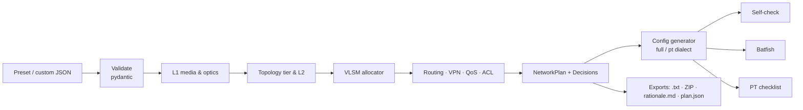

# NetArchitect — Technical Design

> Companion docs: [`idea.md`](idea.md) (what and why) · [`implementation.md`](implementation.md) (phases and gates)
> Status: **design baseline**. Every number marked ⚠ *verify* is a working value to confirm in Phase 0 before code depends on it.

---

## 1. Stack

| Concern | Choice | Why |
|---|---|---|
| Language | Python 3.11 | `ipaddress` stdlib as a test oracle, fast to write. ⚠ *verify* that pybatfish supports the chosen minor version |
| Input models & validation | **pydantic v2** | Typed schemas with precise, field-level error messages (rubric area 1) |
| Config templates | **Jinja2** | One template per device role, with logic kept out of templates |
| Scriptable CLI | **Typer** + **Rich** | Subcommands for tests/automation, pretty tables and panels |
| Interactive terminal GUI | **Textual** | Full TUI: screens, tabs, tables, forms, buttons, mouse support; runs in Windows Terminal |
| Config parsing (self-check) | **ciscoconfparse2** | Reads generated IOS back for invariant checks |
| Network verification | **pybatfish** + Batfish in Docker | Industry config analyser: sessions, routes, ACLs, reachability |
| Tests | **pytest**, **hypothesis**, **pytest-cov**, **syrupy** | Unit tests, property-based tests, golden-file snapshots of configs |
| Lint/format | ruff | One tool, fast |
| Lab | Cisco Packet Tracer 8.x | Required by the spec's verification deliverable |

Exact versions are pinned in `pyproject.toml` during Phase 0. No version is assumed here.

---

## 2. Repository layout

```
netarchitect/
├── README.md                    # screenshots, YouTube demo link, quickstart, rubric map
├── ai_audit_log.md              # mandatory deliverable (spec §4)
├── pyproject.toml               # deps, entry point `netarch`, pytest config, markers
├── docs/
│   ├── idea.md · technical.md · implementation.md
│   └── screenshots/             # README images
├── netarch/
│   ├── cli.py                   # Typer app; no args → launches TUI
│   ├── errors.py                # typed error hierarchy (§13)
│   ├── models/
│   │   ├── requirements.py      # input schema (pydantic)
│   │   ├── decisions.py         # Decision record (§4.2)
│   │   └── plan.py              # NetworkPlan: devices, links, subnets, decisions
│   ├── presets/                 # campus.json · metro.json · global.json
│   ├── data/                    # all constants live here, never in code
│   │   ├── media.yaml           # copper/fibre classes, attenuation, reach
│   │   ├── optics.yaml          # transceivers, budgets, cost rank
│   │   ├── devices.yaml         # PT models, port names, PoE budgets
│   │   ├── standards.yaml       # citation strings (IEEE/TIA/RFC)
│   │   └── pt_capabilities.yaml # Phase-0 matrix: what PT accepts
│   ├── engines/
│   │   ├── l1_media.py          # media + transceiver selection
│   │   ├── optics.py            # power-budget math
│   │   ├── topology.py          # tier selection, link graph
│   │   ├── l2_switching.py      # VLANs, trunks, RSTP, PoE/density
│   │   ├── vlsm.py              # bitwise allocator, summarisation
│   │   ├── routing.py           # protocol, areas, BGP, failover
│   │   ├── vpn.py               # GRE-over-IPsec design
│   │   ├── qos.py               # latency budget, LLQ policy
│   │   └── security.py          # ACL policy matrix
│   ├── explain/
│   │   ├── builder.py           # helpers to build Decision records
│   │   └── render.py            # Decision → plain text / Markdown / Rich
│   ├── configgen/
│   │   ├── interface_map.py     # logical links → physical PT ports
│   │   ├── render.py            # plan + dialect → per-device text
│   │   └── templates/           # router.j2 · l3switch.j2 · l2switch.j2 · partials/*.j2
│   ├── verify/
│   │   ├── selfcheck.py         # pure-Python invariants (§11.1)
│   │   ├── batfish_runner.py    # snapshot build + questions (§11.2)
│   │   └── checklist.py         # Packet Tracer command checklist (§11.3)
│   ├── export/
│   │   └── writer.py            # .txt per device, ZIP, rationale.md, plan.json/csv
│   └── tui/
│       ├── app.py               # Textual App
│       ├── screens/             # home, requirements, design, verify, export
│       └── netarch.tcss         # TUI stylesheet
├── tests/                       # mirrors netarch/ (§14)
├── verification/                # .pkt files, PT screenshots, Batfish reports per profile
└── output/                      # default export folder (git-ignored)
```

---

## 3. Pipeline



Each stage is a **pure function**: plan in, plan out, nothing global. That keeps every engine independently testable and lets the TUI re-run any stage when an input changes.

---

## 4. Data model

### 4.1 Input schema (custom JSON)

```json
{
  "profile_name": "my-campus",
  "profile_type": "campus",
  "address_space": { "root": "10.0.0.0/16", "reserved": ["10.0.255.0/24"] },
  "sites": [
    {
      "id": "bldg-a",
      "kind": "building",
      "segments": [
        { "name": "STAFF", "vlan": 10, "hosts": 300, "growth_pct": 20, "role": "users" },
        { "name": "WIFI",  "vlan": 20, "hosts": 400, "growth_pct": 20, "role": "wireless" },
        { "name": "MGMT",  "vlan": 99, "hosts": 20,  "growth_pct": 0,  "role": "management" }
      ],
      "access_points": 18,
      "access_run_max_m": 85
    }
  ],
  "links": [
    { "a": "bldg-a", "b": "bldg-b", "distance_m": 180, "inter_building": true,
      "required_gbps": 10, "requested_media": null }
  ],
  "resiliency": "dual_uplink",
  "latency_target_ms": null,
  "cloud": null,
  "target_dialect": "pt"
}
```

**Validation rules (pydantic):**

| Field | Rule | Error |
|---|---|---|
| `root` | valid IPv4 network, strict (host bits zero), prefix 8–30 | `InputValidationError` naming the field |
| `vlan` | 2–4094; not 1 (default VLAN) and not 1002–1005 (reserved) | same |
| `hosts` | integer ≥ 1 | same |
| `growth_pct` | 0–200 | same |
| `distance_m` | > 0; ≤ 120,000 | same |
| `requested_media` | if `copper` and distance > 100 m | `PhysicalDistanceViolationError` (spec name, exact) |
| site ids | unique; every link endpoint must exist | `InputValidationError` |
| VLAN ids | unique within a site | same |
| `reserved`, `cloud.vpc_cidr` | inside RFC 1918; must not overlap root allocations | `AddressOverlapError` |
| `resiliency: dual_homed` | every remote site has ≥ 2 links | `TopologyConstraintError` |
| `latency_target_ms` | > 0 | `InputValidationError` |

Validation reports **all** failures at once, not the first, so the TUI can highlight every bad field.

### 4.2 Decision record (the explainability core)

```python
class Rejected(BaseModel):
    option: str                 # "OM4 + 10GBASE-SR"
    reason: str                 # "reach 400 m < 22,000 m required"

class Decision(BaseModel):
    id: str                     # "L1-03"  (domain prefix: L1, L2, L3, RT, VPN, QOS, SEC, TOP)
    domain: Literal["media", "transceiver", "topology", "switching",
                    "addressing", "routing", "vpn", "qos", "security"]
    subject: str                # "Link HQ ↔ Remote-1"
    choice: str                 # "OS2 SMF + 10GBASE-ER"
    rule_id: str                # "MEDIA.R3", traceable to §5 tables
    inputs: dict[str, Any]      # {"distance_m": 22000, "required_gbps": 10}
    math: list[str]             # ["loss = 22 × 0.25 + 2 × 0.5 + 5 × 0.1 = 7.0 dB", ...]
    rationale: str              # natural-language paragraph, generated from the fields above
    standards: list[str]        # ["IEEE 802.3 Cl.52", "TIA-568.3-D"]
    rejected: list[Rejected]
    counterfactual: str | None  # "Would select LR if distance ≤ 10 km and loss ≤ 6.2 dB"
    warnings: list[str]         # "ER would leave only 0.45 dB margin"
    spec_note: str | None       # where we refine the spec (idea.md §5)
```

**Rule:** engines never write prose. They fill fields, and `explain/render.py` turns fields into sentences. That keeps wording consistent and guarantees every rationale is backed by actual inputs and math.

### 4.3 NetworkPlan

`NetworkPlan` = sites, devices (hostname, model, role), links (endpoints, media, optic, subnet, ports), segments (VLAN, subnet, gateway), routing design (process ids, areas, ASNs, router-ids), VPN tunnels, QoS policy, ACL policies, `decisions: list[Decision]`, `warnings`. It is serialisable to `plan.json`, so plans can be diffed in tests.

---

## 5. Layer 1 engine — media and transceivers

### 5.1 Spec baseline rules (implemented exactly)

| Rule | Condition | Choice | Spec rationale |
|---|---|---|---|
| MEDIA.R1 | run ≤ 100 m | Cat6a, 10GBASE-T | IEEE 802.3an 100 m channel |
| MEDIA.R2 | 101–400 m | OM4 MMF, 10GBASE-SR | 850 nm modal dispersion |
| MEDIA.R3 | > 400 m | OS2 SMF, LR/ER chosen by §5.3 | optical budget |
| MEDIA.E1 | copper requested and > 100 m | raise `PhysicalDistanceViolationError` | signal attenuation warning |

Boundary semantics, fixed and tested: 100 m → copper. 100.01 m → fibre. 400 m → OM4. 400.01 m → OS2. Distances are accepted in metres, with up to 2 decimals.

### 5.2 Refinements (explained, never silent)

| Rule | Condition | Behaviour |
|---|---|---|
| MEDIA.X1 | `inter_building: true` and ≤ 100 m | Fibre (OM4) instead of Cat6a. Rationale: ground-potential difference, lightning exposure, EMI. Copper explicitly listed as rejected, with the spec default noted. |
| MEDIA.X2 | access run ≤ 100 m | Rationale states 90 m permanent link + 10 m patch cords (TIA-568.2-D channel model). A warning appears if `access_run_max_m` > 90. |
| MEDIA.X3 | 10G over copper requested on Cat6 | Rejected above 55 m, so Cat6a is required for 100 m at 10G. |
| MEDIA.X4 | any OM4 decision | Rationale says **modal dispersion (bandwidth-distance product)**, never "attenuation"; `spec_note` records the spec's wording. |

### 5.3 Optical power budget (MEDIA.R3 detail)

```
link_loss_dB = L_km × α(λ) + n_conn × c_loss + n_splice × s_loss
n_splice     = max(0, ceil(L_km / reel_km) − 1)
margin_dB    = CIL_dB(optic) − link_loss_dB        # CIL = max channel insertion loss
select: cheapest optic where  L_km ≤ reach_km  AND  margin_dB ≥ min_margin_dB
fallback: no optic meets min_margin but one has margin ≥ 0 → select it with WARNING
none fits → OpticalBudgetExceededError (states shortfall in dB)
```

Why compare against **channel insertion loss** and not add a separate 3 dB margin: the IEEE CIL figure already sits inside the optic's power budget *after* dispersion and other penalties are reserved. Stacking another 3 dB on top double-counts and wrongly rejects LR at around 7 km. `min_margin_dB` (default 1.0 dB) is an *operating* reserve for ageing, repairs and dirty connectors.

**Working constants** (`data/media.yaml`, `data/optics.yaml`), all ⚠ *verify* against IEEE 802.3 Clause 52 tables, TIA-568.3-D and the Cisco transceiver datasheet in Phase 0:

| Constant | Working value |
|---|---|
| α OS2 @ 1310 nm (LR) | 0.35 dB/km |
| α OS2 @ 1550 nm (ER/ZR) | 0.25 dB/km |
| α OM4 @ 850 nm | 3.0 dB/km |
| connector loss | 0.5 dB each (TIA max 0.75), 2 per link |
| splice loss | 0.1 dB each (TIA max 0.3) |
| reel length | 4 km |
| minimum operating margin | 1.0 dB (configurable) |

| Optic | Media | Reach | Budget (channel insertion loss) | Cost rank |
|---|---|---|---|---|
| 10GBASE-T | Cat6a | 100 m | n/a | 1 |
| 10GBASE-SR | OM3 / OM4 | 300 m / 400 m | reach-limited | 2 |
| 10GBASE-LR | OS2 | 10 km | ≈ 6.2 dB | 3 |
| 10GBASE-ER | OS2 | 40 km | ≈ 11 dB | 4 |
| 10GBASE-ZR (vendor, non-IEEE) | OS2 | 80 km | ≈ 23 dB | 5 |

**Worked examples (Metro preset):**

| Link | Loss at 1550 nm (ER) | ER margin (11 − loss) | LR | Result |
|---|---|---|---|---|
| HQ ↔ Colo, 15 km | 3.75 + 1.0 + 0.3 = 5.05 dB | 5.95 dB ✓ | ✗ reach 10 km | **ER** |
| HQ ↔ Remote-1, 22 km | 5.50 + 1.0 + 0.5 = 7.00 dB | 4.00 dB ✓ | ✗ reach | **ER** |
| HQ ↔ Remote-2, 35 km | 8.75 + 1.0 + 0.8 = 10.55 dB | 0.45 dB ✗ (< 1.0) | ✗ reach | **ZR** (margin 12.45 dB), warning: non-IEEE vendor optic; ER would work with only 0.45 dB to spare |

Campus-style LR sanity check: 10 km at 1310 nm → 3.5 + 1.0 + 0.2 = 4.7 dB, margin 1.5 dB ✓ → **LR**. 10.01 km → LR reach exceeded → ER.

The 35 km case is a deliberate demo moment. Distance alone says "ER is fine (≤ 40 km)", but the budget leaves almost no reserve. That's exactly the kind of mistake an AI makes.

### 5.4 Transceiver decision

Transceiver choice is its own `Decision` (domain `transceiver`), separate from media, because the rubric names both.

---

## 6. Topology and Layer 2

### 6.1 Topology tier (TOP.R1–R3)

| Rule | Condition | Tier |
|---|---|---|
| TOP.R1 | 1 building, ≤ 500 endpoints | Two-tier, collapsed core in one switch block |
| TOP.R2 | 2–4 buildings/distribution blocks | Two-tier collapsed core: one L3 distribution switch per building, routed inter-building links (full mesh if ≤ 3, else hub) |
| TOP.R3 | > 4 distribution blocks or > 5,000 endpoints | Three-tier with dedicated core |

Math in the rationale: full mesh of *n* distribution blocks needs n(n−1)/2 links (3 → 3, 5 → 10, 8 → 28). A dedicated core turns that into n uplinks. Campus (3 buildings) → TOP.R2, full-mesh triangle.

### 6.2 Switching design

- **VLANs:** one per segment per site. Native VLAN **999** (unused, no SVI). VLAN 1 is never used for data.
- **Trunks:** `switchport mode trunk`, `switchport trunk allowed vlan <exact list>`, `switchport trunk native vlan 999`, `switchport nonegotiate`. On 3560: `switchport trunk encapsulation dot1q` **before** mode trunk. On 2960: that command does not exist, so it's not emitted (dialect rule).
- **Access ports:** `switchport mode access`, `spanning-tree portfast`, `spanning-tree bpduguard enable`.
- **RSTP:** `spanning-tree mode rapid-pvst`. The building's L3 switch is `root primary` for all its VLANs, so the STP root coincides with the SVI gateway and traffic doesn't detour.
- **L3 boundary:** SVIs on the building distribution switch (`ip routing` enabled). Inter-building links are **routed** (`no switchport`), so RSTP domains stay inside one building.

### 6.3 Capacity and density checks (rubric: "density" validation)

| Check | Formula | Failure |
|---|---|---|
| Access ports | wired endpoints + APs + uplinks ≤ ports × switches | `CapacityError` with switch count needed |
| PoE | APs × 30 W (802.3at Class 4 at the PSE) ≤ switch PoE budget | `CapacityError` / recommendation to add PoE switches |
| AP density | clients per AP ≤ design constant (default 40) | warning |

These shape the **bill of materials** (real design). The Packet Tracer lab is **representative**: one distribution and one access switch per building, plus 1–2 PCs per VLAN, not 1,600 hosts.

### 6.4 Physical recommendation vs lab mapping

The design recommends 10G links (Cat6a, OM4, ER optics). The PT lab uses 2911/3560/2960 ports (GigabitEthernet/FastEthernet). `configgen/interface_map.py` maps every logical link to concrete PT port names. The rationale log states both:

> *"Physical: OM4 + 10GBASE-SR. Lab mapping: Gi0/1 on dist-a ↔ Gi0/1 on dist-b (Packet Tracer port speed differs; logical config identical)."*

Configs always use the real PT port names, so they paste in without edits.

---

## 7. Addressing — bitwise VLSM engine

### 7.1 Primitives (pure integer math; `ipaddress` used only in tests)

```python
FULL = 0xFFFFFFFF
mask(p)         = (FULL << (32 - p)) & FULL        # p = 0 → 0, p = 32 → FULL
wildcard(p)     = ~mask(p) & FULL
network(ip, p)  = ip & mask(p)
broadcast(ip,p) = network(ip, p) | wildcard(p)
block_size(p)   = 1 << (32 - p)
usable(p)       = 2 for /31 (RFC 3021), 1 for /32, else block_size(p) - 2
first_host      = network + 1 (except /31: network; /32: network)
last_host       = broadcast - 1 (except /31: broadcast; /32: network)
is_aligned(n,p) = (n & wildcard(p)) == 0
dotted(x)       = f"{x>>24 & 255}.{x>>16 & 255}.{x>>8 & 255}.{x & 255}"
```

### 7.2 Sizing rule (explicit and documented)

```
needed      = ceil(hosts × (1 + growth_pct/100)) + 1        # +1 = default gateway
prefix      = 32 − ceil(log2(needed + 2))                    # +2 = network + broadcast
```

So **253 hosts fits a /24, and 254 hosts needs a /23**, because the gateway takes one address. This choice is stated in every addressing decision, since it is a common off-by-one source.

Special segments:
- **Point-to-point links:** /31 (RFC 3021) if the target supports it (⚠ *verify* in the PT capability matrix), else /30.
- **Loopbacks:** /32 (router-ID for OSPF/BGP).

### 7.3 Allocation algorithm (hierarchical)

```
allocate(root, sites):
  1. infra block: reserve one block for all /31 links + /32 loopbacks
  2. per site: demand = Σ block_size(segment); site_prefix = smallest p with block_size(p) ≥ demand
  3. sort site blocks (and infra) by size DESC, then id ASC   # deterministic
  4. cursor = root.network
     for blk in sorted:
        cursor = align_up(cursor, blk.size)                   # no-op when sorted desc
        if cursor + blk.size > root.broadcast + 1:
            raise AddressSpaceExhaustedError(requested, available, shortfall)
        assign; cursor += blk.size
  5. inside each site block: repeat step 3–4 for its segments
  6. return allocations + free space list
```

**Why it's correct:** blocks sorted by descending power-of-two size always land on aligned boundaries with no gaps (each block's size divides every larger one). Allocating per site first means every site occupies **one contiguous, aligned block**, so its summary route is exactly that block. Summarisation is guaranteed by construction, not hoped for.

### 7.4 Summarisation

```
summarise(blocks):  common prefix of min(network) and max(broadcast)
exactness check:    summary must not contain any block assigned elsewhere
```

Used for `area <n> range` (OSPF ABR) and the BGP advertisement to the cloud.

### 7.5 Outputs and efficiency metrics

Per subnet: name, VLAN, network/prefix, mask, **wildcard**, gateway, first/last usable, broadcast, usable count, requested hosts, utilisation % (= requested ÷ usable).
Global: allocated ÷ root size, largest free block, waste by sizing (rounding up to a power of two) vs waste by growth headroom, reported separately.

### 7.6 Errors

- `AddressSpaceExhaustedError`: "Requested 70,144 addresses (after rounding) but 10.0.0.0/16 holds 65,536; short by 4,608. Smallest root that fits: /15."
- `AddressOverlapError`: custom reserved ranges or a cloud VPC CIDR overlapping the plan.
- `InputValidationError`: non-strict root (host bits set), prefix outside 8–30.

---

## 8. Routing, VPN, QoS and security

### 8.1 Protocol selection

| Rule | Condition | Choice | Rationale (summary) |
|---|---|---|---|
| RT.R1 | single org, single routing domain, < 50 subnets | OSPFv2, single area 0 | link-state, fast convergence, small LSDB; full SPF cost is trivial at this size (RFC 2328) |
| RT.R2 | multi-site WAN **or** ≥ 50 subnets | multi-area OSPF | areas limit LSA flooding and SPF scope; ABR summarisation hides per-site churn |
| RT.R3 | boundary with another administrative domain (cloud/provider) | eBGP, private ASNs (RFC 6996, 64512–65534) | policy-based inter-domain routing; cloud gateways speak BGP, not OSPF |
| RT.R4 | OSPF over Internet-based VPN | GRE-over-IPsec tunnels | OSPF hellos are multicast and policy-based IPsec carries no multicast; GRE encapsulates it (RFC 2784) |

The subnet count used by RT.R1/R2 includes p2p links and loopbacks, and the rationale shows the count.

### 8.2 OSPF details (all profiles)

- Router-ID = loopback /32. `passive-interface default` with `no passive-interface` only on transit links. User SVIs never form adjacencies.
- `auto-cost reference-bandwidth 10000` (10 Gbps) on **every** router. Without it, 1G and 10G links both cost 1. Rationale includes cost = ref ÷ bandwidth.
- `network <net> <WILDCARD> area <n>`. Wildcard comes from §7.1 and is tested.
- Point-to-point links: `ip ospf network point-to-point` (no DR/BDR election).
- **Metro failover:** `ip ospf hello-interval 1` / `dead-interval 4` on EVPL links. Primary/backup path through OSPF cost. Rationale: default dead timer 40 s vs 4 s, so failover time is bounded by detection plus SPF. (BFD is the real-world answer, documented as out of scope because PT does not support it.)

### 8.3 Profile-specific routing designs

**Campus:** 3 distribution L3 switches in a triangle of routed /31 links, all area 0. SVIs advertised as passive interfaces.

**Metro:**
- HQ router plus Remote-1 and Remote-2 routers, and the Colo router.
- Carrier **EVPL** modelled as 802.1Q sub-interfaces (`interface Gi0/1.101`, `encapsulation dot1Q 101`). One physical handoff carries several EVCs, as carriers actually deliver.
- **Dual-homed:** each remote has an EVPL to HQ (primary, lower cost) and one to Colo (backup).
- Single-area OSPF (RT.R1).

**Global:**
- 4 city routers plus an HQ hub (one city is HQ) and `cloud-vgw` (a 2911 emulating the cloud VPC gateway).
- Area 0 = HQ core plus all GRE tunnels. Each city LAN = area *n*. City routers are ABRs with `area n range <city block>`.
- HQ ↔ cloud: eBGP over IPsec. Org AS 65001 ↔ cloud AS 64512. HQ advertises the org summary (anchored with a `Null0` static), and cloud advertises the VPC CIDR (e.g., 172.31.0.0/16, validated non-overlapping).
- VPC prefix redistributed into OSPF at HQ through a route-map with a prefix-list, so only the VPC prefix enters OSPF.

### 8.4 GRE-over-IPsec (IKEv1 crypto map — widest PT support)

```
crypto isakmp policy 10
 encr aes 256
 hash sha256            ! pt dialect may need: hash sha        ⚠ verify
 authentication pre-share
 group 14               ! pt dialect may need: group 5         ⚠ verify
crypto isakmp key <PSK> address <peer-public-ip>
crypto ipsec transform-set TS esp-aes 256 esp-sha256-hmac   ! pt: esp-sha-hmac ⚠
access-list 110 permit gre host <local-public> host <peer-public>
crypto map CMAP 10 ipsec-isakmp
 set peer <peer-public-ip>
 set transform-set TS
 match address 110
interface Gi0/0
 crypto map CMAP
interface Tunnel<n>
 ip address <tunnel /31 or /30>
 tunnel source Gi0/0
 tunnel destination <peer-public-ip>
 ip mtu 1400
 ip tcp adjust-mss 1360
 ip ospf network point-to-point
```

- PSKs are generated randomly per tunnel at export, written into the configs and listed in `secrets.txt` (git-ignored), with a warning.
- MTU/MSS rationale: GRE (24 B) + IPsec ESP overhead (~50–73 B) would otherwise cause fragmentation.
- On 2911 in PT, the security license must be enabled first (`license boot module c2900 technology-package securityk9`, then reload). The PT checklist includes this step.

### 8.5 QoS and the latency model (Metro "sub-5 ms")

```
propagation_ms   = L_km × 0.005               # ≈ 5 µs/km in fibre (n ≈ 1.47)
serialisation_ms = (frame_bytes × 8) / link_bps × 1000 × hops
processing_ms    = hops × per_hop_ms           # default 0.05 ms, ⚠ assumption
queuing_budget   = target_ms − (above)
```

Example: HQ ↔ Remote-2, 35 km, 2 hops, 1500 B at 1 Gbps → 0.175 + 0.024 + 0.10 = **0.30 ms**, leaving **4.7 ms for queuing**. So the design generates LLQ, because queuing is the only term that can break 5 ms:

```
class-map match-any TRADING
 match dscp ef
policy-map WAN-EDGE
 class TRADING
  priority percent 30
 class class-default
  fair-queue
interface Gi0/1
 service-policy output WAN-EDGE
```

Classification/marking at the trading VLAN ingress (DSCP EF, RFC 3246). ⚠ *verify* MQC support in PT. If unsupported, the `pt` dialect omits the block, and the omission is listed in the config header and the rationale. The `full` dialect keeps it and Batfish parses it.

### 8.6 ACL policy (rubric names ACLs explicitly)

Policies are declared as a matrix (source segment × destination segment → permit/deny/ports) and compiled to **extended ACLs placed close to the source** (inbound on the source SVI/sub-interface):

| Profile | Policy |
|---|---|
| Campus | WIFI → MGMT: deny. WIFI → SERVERS: permit tcp 80/443 and udp 53 only. Everything else permitted. VTY: `access-class` permits MGMT subnet only, SSH only. |
| Metro | Colo TRADING subnet reachable only from HQ TRADING VLAN (tcp, configured ports). Deny and log the rest. |
| Global | IoT → collector servers: tcp 8883/443. IoT → DNS/NTP infra. Deny ip any any log. Cloud VPC reachable from HQ servers only. |

Every ACL ends with an explicit deny (with `log` where the dialect supports it), so the implicit deny becomes visible in the configs and in Batfish.

---

## 9. Config generation

### 9.1 Device catalogue (`data/devices.yaml`)

| Role | PT model | Ports (PT) | Notes |
|---|---|---|---|
| WAN / edge router | Cisco **2911** | Gi0/0–Gi0/2 | EVPL via sub-interfaces; securityk9 for IPsec |
| L3 distribution | Catalyst **3560-24PS** | Fa0/1–24 (PoE), Gi0/1–2 | `ip routing`; trunk encapsulation required |
| L2 access | Catalyst **2960-24TT** | Fa0/1–24, Gi0/1–2 | L2 only; `ip default-gateway` on MGMT SVI |
| Cloud VPC gateway | 2911 (emulated) | | named `cloud-vgw`, AS 64512 |

### 9.2 Dialects

| Dialect | Purpose | Differences |
|---|---|---|
| `full` | Batfish + real IOS | sha256/group 14, MQC QoS, `log` on ACL denies, everything included |
| `pt` | paste into Packet Tracer | features PT rejects are removed or downgraded per `pt_capabilities.yaml`; each removal is listed in a `! NETARCH-PT-COMPAT:` header comment |

Both dialects come from the same templates with dialect flags. Templates never contain design logic; they only render plan fields.

### 9.3 Config skeleton order (per device)

`hostname` → `service password-encryption` → `no ip domain-lookup` → banner → users/SSH (`ip domain-name`, `crypto key generate rsa modulus 2048` note, `line vty` `transport input ssh`, `login local`, `access-class`) → VLAN database → `spanning-tree` → interfaces (physical, sub, SVI, loopback, tunnel) → `ip routing` (L3 switch) → routing processes → static/Null0 routes → prefix-lists/route-maps → ACLs → crypto → QoS → `end`.

Header comment on every file: profile, device role, dialect, generator version, timestamp, and "generated by NetArchitect — see rationale.md".

### 9.4 Exports (`export/writer.py`)

| File | Content |
|---|---|
| `configs/<hostname>.txt` | one per device; this is the user's "download .txt" |
| `netarch-<profile>-configs.zip` | all device configs + rationale + checklist |
| `rationale.md` | every Decision rendered, grouped by domain |
| `ip-plan.csv`, `plan.json` | addressing table; full machine-readable plan |
| `pt-checklist.md` | PT steps + verification commands + expected results |
| `topology.mmd` | Mermaid diagram of devices and links |
| `batfish-report.md` | latest verification results (if run) |
| `secrets.txt` | generated PSKs/passwords (git-ignored) |

---

## 10. CLI and TUI

### 10.1 Commands (Typer)

```
netarch                                   # no args → launch TUI
netarch presets                           # list presets
netarch validate  --input custom.json     # validation only
netarch design    --preset campus | --input custom.json  [--json]
netarch explain   --preset metro [--id L1-03] [--domain routing]
netarch plan      --preset global         # VLSM table
netarch export    --preset campus --out ./output [--zip] [--dialect pt|full] [--only configs]
netarch verify    --preset campus [--no-batfish] [--batfish-host localhost]
netarch checklist --preset campus
```

Exit codes: `0` ok · `1` verification failed · `2` input invalid · `3` design constraint error (distance, budget, exhaustion, capacity). Errors print as a Rich panel with the field, value, rule and fix hint, never a stack trace (`--debug` shows it).

### 10.2 TUI (Textual)

| Screen | Contents |
|---|---|
| **Home** | Three preset cards (Campus/Metro/Global) + "Load custom JSON" + "New from template" |
| **Requirements** | Editable form (sites, segments, links); live validation with errors inline beside fields |
| **Design** (tabs) | **Summary** (devices, links, key choices) · **Decisions** (tree by domain; expand for math, rejected options, counterfactual, standards) · **IP Plan** (sortable DataTable incl. wildcard) · **Topology** (text diagram) · **Configs** (device list + syntax-highlighted viewer + copy) |
| **Verify** | Buttons: Self-check · Batfish. Live log; results table with ✓/✗ and the word PASS/FAIL (never colour alone); Batfish status badge |
| **Export** | Checkboxes for each artefact, dialect toggle, destination path, **Export** button → shows written file paths; "ZIP all" button |

Keys: `d` design · `v` verify · `e` export · `?` help · `q` quit. Works with mouse and keyboard. Target terminal: Windows Terminal ≥ 120 × 35.

### 10.3 What-if control

On the Requirements screen, changing a link distance re-runs L1 instantly, and the Decisions tab shows the new choice (e.g., 95 → 105 → 450 → 12,000 → 36,000 m walks copper → OM4 → OS2-LR → OS2-ER → ZR).

---

## 11. Verification

### 11.1 Self-check (pure Python, always available)

Parses the generated configs with ciscoconfparse2 and asserts:

1. Every interface IP lies inside its planned subnet and is not the network/broadcast address (except /31).
2. No duplicate IP across devices; no overlapping subnets.
3. Both ends of every link share the same subnet and mask.
4. Every VLAN used on access/trunk ports exists in that switch's VLAN database.
5. Trunk `allowed vlan` lists equal the planned set; native VLAN = 999 on both ends; never VLAN 1.
6. 3560 trunks include `encapsulation dot1q`; 2960 configs never contain it.
7. `ip routing` present on every L3 switch with SVIs.
8. OSPF `network` statements use valid wildcards (inverse of a contiguous mask) and cover every transit interface; router-IDs unique.
9. Every ACL referenced (`ip access-group`, `access-class`, `match address`) is defined, and vice versa.
10. GRE tunnel source/destination pairs are mirror images; crypto ACLs mirror each other.
11. Hostnames unique; no `enable password` in clear text.

Output: list of `CheckResult(id, device, status, message)`. Any FAIL → exit code 1.

### 11.2 Batfish

**Setup** (documented in README):

```
docker run --name batfish -v batfish-data:/data -p 9996:9996 -p 9997:9997 batfish/allinone
```

⚠ *verify* image name/ports in Phase 0.

**Snapshot layout** built by `batfish_runner.py` from the `full` dialect:

```
snapshot/
  configs/<hostname>.cfg
  hosts/<pc>.json          # representative end hosts for traceroute
```

**Questions → assertions:**

| Check | pybatfish question | Pass condition |
|---|---|---|
| Configs parsed | `fileParseStatus`, `initIssues`, `parseWarning` | all PASSED, no errors |
| References | `undefinedReferences` | empty |
| Duplicate IPs | `ipOwners(duplicatesOnly=True)` | empty |
| OSPF | `ospfSessionCompatibility`, `ospfEdges` | all sessions established; edge count = planned adjacencies |
| BGP (Global) | `bgpSessionStatus` | HQ ↔ cloud-vgw ESTABLISHED |
| IPsec (Global) | `ipsecSessionStatus` | every tunnel established |
| Summaries | `routes` on HQ | each city summary present; per-city /24s absent |
| ACL hygiene | `filterLineReachability` | no unreachable (shadowed) lines |
| Policy | `searchFilters` | no permitted flow IoT → non-collector |
| Reachability | `traceroute` per policy matrix row | permits ACCEPTED, denies DENIED |
| Failover (Metro) | `traceroute` on a fork with the primary EVPL shut (`bf.fork_snapshot`, deactivate interfaces) | path moves via Colo |

**Graceful degradation:** if Batfish is unreachable within 3 s, verification reports `BATFISH: NOT CONNECTED (skipped)` and still runs the self-check. Tests marked `@pytest.mark.batfish` are deselected from the test gate (`-m "not batfish"`) and run separately with Docker up. A saved `batfish-report.md` from the last good run can be shown in the TUI as a backup for the demo.

### 11.3 Packet Tracer checklist (generated)

Per profile: PT device list with models → cabling table (device/port ↔ device/port) → load steps (Config tab → load/merge `.txt`, securityk9 + reload where needed) → verification commands with expected results:

```
dist-a# show vlan brief            → VLANs 10,20,99 active
dist-a# show interfaces trunk      → allowed 10,20,99 · native 999
dist-a# show ip ospf neighbor      → 2 neighbors, FULL
hq#     show crypto isakmp sa      → QM_IDLE to each city (Global)
pc-wifi> ping 10.0.x.x (MGMT)      → FAIL expected (ACL)
pc-staff> ping 10.0.y.y (server)   → success
```

---

## 12. Packet Tracer compatibility matrix (filled in Phase 0)

`data/pt_capabilities.yaml`, one row per feature, tested by pasting into PT:

| Feature | Device | Expected | Result |
|---|---|---|---|
| `switchport trunk encapsulation dot1q` | 3560 | accepted | ☐ |
| `spanning-tree mode rapid-pvst` | 3560/2960 | accepted | ☐ |
| routed port `no switchport` + /31 | 3560 | /31 uncertain | ☐ |
| /31 on router interface | 2911 | uncertain | ☐ |
| dot1Q sub-interfaces | 2911 | accepted | ☐ |
| `auto-cost reference-bandwidth` | 2911/3560 | accepted | ☐ |
| `area n range` | 2911 | accepted | ☐ |
| OSPF hello/dead timers | 2911 | accepted | ☐ |
| eBGP `neighbor`/`network`, Null0 anchor | 2911 | accepted | ☐ |
| prefix-list / route-map redistribution | 2911 | uncertain | ☐ |
| GRE tunnel | 2911 | accepted | ☐ |
| IKEv1 crypto map (after securityk9) | 2911 | accepted | ☐ |
| sha256 / group 14 / esp-sha256-hmac | 2911 | uncertain | ☐ |
| MQC class-map/policy-map/priority | 2911 | uncertain | ☐ |
| `ip tcp adjust-mss`, `ip mtu` on tunnel | 2911 | uncertain | ☐ |
| extended ACL on SVI, `log` keyword | 3560 | uncertain | ☐ |
| SSH (`crypto key generate rsa`) | all | accepted | ☐ |

Every "rejected" row becomes a `pt` dialect downgrade rule plus a line in the rationale.

---

## 13. Error hierarchy

```
NetArchError
├── InputValidationError            # wraps pydantic errors; lists every bad field
├── PhysicalDistanceViolationError  # copper requested > 100 m (spec name, exact)
├── OpticalBudgetExceededError      # no optic fits loss (+ margin); states shortfall dB
├── AddressSpaceExhaustedError      # requested vs available, shortfall, smallest fitting root
├── AddressOverlapError             # reserved/VPC/custom ranges collide
├── TopologyConstraintError         # e.g. dual_homed with a single path
├── CapacityError                   # ports or PoE budget exceeded
└── VerificationError               # self-check / Batfish failures (exit 1)
```

Each error carries `field`, `value`, `rule_id`, `message`, `hint`. `PhysicalDistanceViolationError` message template:

> *"Copper requested for link bldg-a ↔ bldg-c at 120 m. Category 6a / 10GBASE-T is limited to a 100 m channel (IEEE 802.3an); beyond this, insertion loss and crosstalk exceed receiver tolerance. Use OM4 multimode fibre (10GBASE-SR, ≤ 400 m)."*

---

## 14. Testing

### 14.1 Layers

| Layer | Tooling | Scope |
|---|---|---|
| Unit | pytest | every engine function, every rule boundary |
| Property-based | hypothesis | VLSM: random roots + request sets vs `ipaddress` oracle |
| Golden files | syrupy | rendered configs per preset × dialect. Any change shows as a diff |
| Integration | pytest | preset → plan → configs → self-check, end to end |
| Batfish | `@pytest.mark.batfish` | §11.2 assertions; deselected from the test gate (`-m "not batfish"`), run separately with Docker up |

Coverage target: ≥ 90 % on `engines/`, ≥ 80 % overall.

### 14.2 Required test catalogue (rubric area 4 names these)

**Distance violations**
- copper at 100 m passes; at 100.01 m and 120 m raises `PhysicalDistanceViolationError`
- 400 m → OM4; 400.01 m → OS2; 10 km → LR; 10.01 km → ER; 35 km → ZR with warning; 81 km → `OpticalBudgetExceededError`
- inter-building 60 m → fibre (refinement); access run 95 m → warning

**Address space exhaustion**
- demand exactly equals root (fits, 100 % utilisation)
- demand one address over → error with correct shortfall
- many small subnets fragment-free (sorted) vs adversarial order (unsorted input still allocates correctly)
- /30 root with 2 hosts; /32 root rejected

**Wildcard masks across edge subnets**
- /0 → 255.255.255.255 · /8 → 0.255.255.255 · /24 → 0.0.0.255 · /30 → 0.0.0.3 · /31 → 0.0.0.1 · /32 → 0.0.0.0
- every prefix 0–32 against `ipaddress` (`hostmask`)

**VLSM properties (hypothesis, ≥ 1,000 examples)**
- no two allocations overlap
- every allocation is aligned and inside the root
- every allocation's usable count ≥ needed
- each site's segments lie inside the site block, and the summary equals the site block
- 253 hosts → /24; 254 → /23 (gateway rule)

**Explainability**
- every decision has non-empty rationale, ≥ 1 standard, and ≥ 1 rejected alternative where alternatives exist
- rationale numbers equal the inputs (e.g., "22 km" appears for a 22,000 m link)

**Configs**
- 3560 trunk contains encapsulation; 2960 never does
- no `switchport trunk allowed vlan all`; native never 1
- OSPF network statements use wildcards
- self-check passes on all 3 presets × 2 dialects

---

## 15. Standards cited by the engine

| Ref | Used for |
|---|---|
| IEEE 802.3an | 10GBASE-T, 100 m |
| IEEE 802.3ae / 802.3 Cl. 52 | 10GBASE-SR/LR/ER reach and budgets |
| IEEE 802.3at | PoE+ (30 W at PSE) |
| IEEE 802.1Q | VLAN tagging, trunks, EVPL tags |
| IEEE 802.1w (in 802.1D-2004) | RSTP |
| TIA-568.2-D / 568.3-D | copper channel model; fibre/connector/splice loss limits |
| RFC 950, RFC 1878, RFC 4632 | subnetting, VLSM, CIDR |
| RFC 1918 | private address space |
| RFC 3021 | /31 point-to-point |
| RFC 2328 | OSPFv2 |
| RFC 4271, RFC 6996 | BGP-4, private ASNs |
| RFC 2784 | GRE |
| RFC 4301, RFC 4303 | IPsec architecture, ESP |
| RFC 2474, RFC 3246 | DSCP, EF PHB |

---

## 16. Known limitations (stated honestly in README and viva)

- The Packet Tracer lab is **representative**, not full scale; port speeds differ from the 10G physical recommendation.
- Optical constants are working values from standards/datasheets; real links need OTDR measurement.
- Batfish models control and data plane from configs; it does not emulate timing (convergence speed) or wireless.
- The `pt` dialect drops features PT cannot parse; the `full` dialect is the authoritative design.
- BFD, HSRP/VRRP, IPv6 and 802.1X are out of scope (named as future work).
